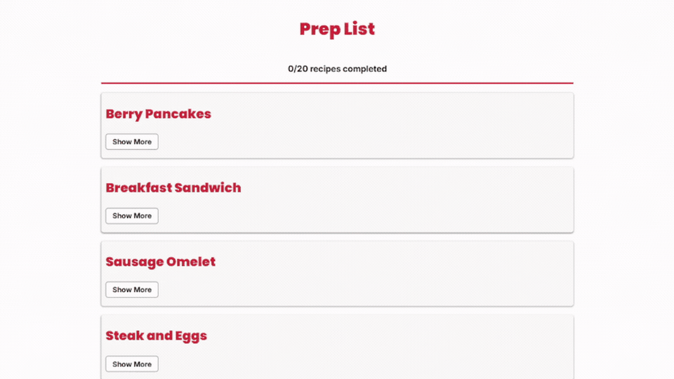
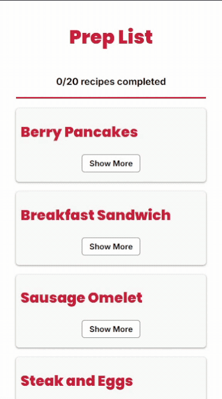

# Interactive Prep List

A kitchen management resource for tracking recipe preparation and completion. It's designed for professional kitchens that rely on traditional methods to organize daily prep.

## The problem

This tool helps reduce confusion about which recipes need to be prepared for a day's service while allowing kitchen employees to track what has been completed. Employees can also add recipe groups and recipes as their prep needs change during a session.

## How to run it

You need nothing installed to use the live version.

1. Open the [live page](https://azizamassri.github.io/interactive-prep-list/).
2. The page displays a completion counter, recipe groups, and an **Add a Recipe** form.
3. Select **Show More** to expand a recipe group and view its individual recipes.
4. Select **Details** on a recipe to view its yield, ingredients, quantities, and units.
5. Check **Done** to complete a recipe. Its name turns grey, its details and checkbox are hidden, and the completion counter increases. When every recipe in a group is complete, the group heading also turns grey.
6. To add a group, enter a **Recipe Group** name in the form. Fill in the recipe title, yield, and ingredient details. Use **Add Another Ingredient** and **Add Another Recipe** as needed, then select **Add**.
7. The new group appears above the form. Its recipes can be expanded and marked complete just like the original recipes, and the total recipe count updates.

**Note:** New recipes and completion progress are stored only for the current session. Reloading the page or successfully retrying a data load restores the recipes from `recipeGroups.json`; it does not save your additions or completion status.

If the initial recipe load fails, an error message and **Retry** button appear. If a later refresh fails, the previously displayed recipes remain available while you retry.

To run a local copy, clone or download the repository and serve the project folder using a local development server. The JSON data is loaded with `fetch()`, so opening `index.html` directly as a local file may not work.

## Demo

Both demos show the same workflow: expanding recipe groups, viewing recipe details, marking recipes complete, and adding a new group with multiple recipes and ingredients. The desktop recording also shows collapsing a completed group.

### Desktop

### Mobile

## What it looks like when it works

For example, on the live page:

1. Expand **Berry Pancakes** using **Show More**.
2. Open **Details** and mark **Pancakes**, **Strawberry Topping**, and **Whipped Topping** as **Done**.
3. Expand **Breakfast Sandwich** and open **Details** for **Toasted English Muffins**.

The completion counter should show **3/20 recipes completed**. The completed recipes and the Berry Pancakes heading should be grey, while Toasted English Muffins should display its yield and ingredients.

You can also use the form to add a group such as **Chicken and Waffles**, with recipes such as **Breaded Chicken Filets** and **Buttermilk Waffles**. Adding two recipes increases the total from 20 to 22; marking one Done increases the completed count by one.

## How I built it

- Built with JavaScript, HTML, and CSS, starting in CodePen and continuing in VS Code and GitHub, with deployment through GitHub Pages.
- Stored the invented recipe data in `recipeGroups.json` and loaded it using the Fetch API.
- Used nested arrays and objects, loops, DOM manipulation, functions, and event listeners to display expandable recipe groups and details.
- Added checkboxes and a completion counter to track progress across recipes and groups.
- Built an **Add a Recipe** form that accepts new groups, multiple recipes, yields, ingredients, quantities, and units. New groups are displayed using the same rendering function as the JSON-loaded groups.
- Added error handling and a **Retry** button for failed data loads, preserving previously displayed recipes when a refresh fails.
- Fixed duplicate elements and inconsistent counter updates after retrying by reusing the form and sharing the counter variables across event listeners.
- Styled the interface for mobile and desktop screens.
- **AI use:** I used My Code Coach for explanations, hints, and troubleshooting throughout development. Topics included nested arrays and objects, nested loops, DOM manipulation, event listeners, recipe completion logic, counters, loading data from JSON, error handling, form creation, and debugging Retry behavior. I also received guidance on CSS styling and code cleanup. I implemented and tested the JavaScript and CSS myself. AI also assisted with preparing the demo GIFs and updating this README.

## What I would change next

- Add local storage so completion progress and user-entered recipes persist across page visits.
- Add a way to edit or remove recipe groups and recipes after they have been created.

## Files

- `index.html`: Page structure and links to the stylesheet and script.
- `style.css`: Responsive styling for the layout, counter, recipe groups, buttons, and form.
- `script.js`: Loads recipe data, renders groups and recipes, handles completion and form interactions, and manages loading errors and retries.
- `recipeGroups.json`: Stores the initial recipe groups, recipes, yields, and ingredient details.
- `plan.md`: Capstone plan, implementation notes, test cases, and pseudocode.
- `assets/`: Mobile and desktop demo GIFs and other project assets.
